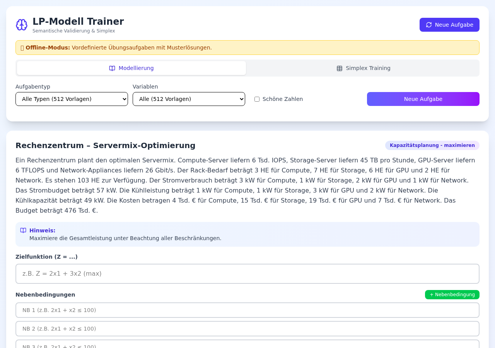

# LP-Modell Trainer

Web-App zum Üben der Modellierung linearer Optimierungsprobleme (LP) und des Simplex-Verfahrens.

- Textaufgaben in ein LP-Modell übersetzen (Entscheidungsvariablen, Zielfunktion, Nebenbedingungen), mit Prüfung und markierten Schlüsselstellen im Aufgabentext
- Simplex-Tableaus selbst rechnen und Schritt für Schritt prüfen lassen
- 16 Aufgabentypen (Produktion, Mischung, Transport, Diät, Schichtplanung, Energiemix, …) mit 2 bis 5 Variablen
- 421 feste Aufgaben plus 512 Vorlagen, aus denen beliebig viele Varianten mit „glatten“ Zahlen erzeugt werden
- Läuft komplett lokal im Browser, der Simplex-Löser braucht keinen Server

**▶ Live-Demo: <https://h4ms7.github.io/lp-modell-trainer/>** – läuft direkt im Browser, ohne Installation.

**Autor:** Felix Flösch ([@H4MS7](https://github.com/H4MS7))



## Lokal starten

Voraussetzung: [Node.js](https://nodejs.org/) 20.19+ oder 22.12+ (empfohlen: aktuelle LTS-Version).

```bash
cd app
npm install
npm run dev
```

Danach im Browser <http://localhost:5173/> öffnen.

### Als statische Seite bauen

```bash
cd app
npm run build      # Ergebnis landet in app/dist/
npm run preview    # gebaute Version lokal ansehen
```

Den Inhalt von `app/dist/` kann man auf jeden Webserver legen, auch in einen Unterordner. Direkt per Doppelklick (`file://`) funktioniert die gebaute Seite nicht.

Die Live-Demo wird bei jedem Push auf `main` automatisch über GitHub Actions gebaut und auf GitHub Pages veröffentlicht (`.github/workflows/pages.yml`).

## KI-Modus vs. Offline-Modus

Die App wurde ursprünglich als Claude-Artifact gebaut und versucht beim Start, die Claude-API zu erreichen (Aufgabengenerierung und KI-Feedback). Außerhalb von claude.ai ist dafür kein API-Key hinterlegt, deshalb startet sie im **Offline-Modus** (gelber Hinweis oben). Alle Kernfunktionen (Aufgaben, Varianten, Modellprüfung, Simplex-Prüfung) funktionieren offline.

## Projektstruktur

```
app/                    React-App (Vite + TypeScript + Tailwind)
  src/LPModellTrainer.tsx   Hauptkomponente
  src/lib/                  Simplex-Löser, Bruchrechnung, Aufgabengenerator, Template-Engine
  src/data/                 Aufgaben (problems.ts) und Vorlagen (templates.ts), generiert
  src/test-*.ts             Testskripte
problems/               Aufgabendaten und Python-Skripte zur Erzeugung/Prüfung
  templates/<typ>/          Vorlagen je Aufgabentyp (JSON)
  batch_*.json              feste Aufgaben, zusammengeführt in all_problems.json
  SCHEMA.md                 JSON-Format der Aufgaben
  CATALOGUE.md, TEMPLATE_CATALOGUE.md   Übersicht aller Aufgaben/Vorlagen
```

## Tests

```bash
cd app
npx tsx src/test-harness.ts all
npx tsx src/test-multivar-flow.ts
```

`tsx` ist keine Projektabhängigkeit, `npx` lädt es beim ersten Aufruf herunter.

## Eigene Vorlagen ergänzen (optional, Python 3)

Neue Vorlagen als JSON in `problems/templates/<typ>/` ablegen (Format siehe `problems/SCHEMA.md` und vorhandene Dateien), dann:

```bash
python3 problems/validate_templates.py   # Vorlagen prüfen
python3 problems/merge_templates.py      # nach app/src/data/templates.ts übernehmen
cd app && npm run build                  # Typprüfung + Build
```

## Fehler gefunden? Ideen?

Gerne als [Issue](https://github.com/H4MS7/lp-modell-trainer/issues) melden, zum Beispiel eine Aufgabe mit falscher Lösung oder unklarem Text.

## Lizenz

Copyright (C) 2026 Felix Flösch

Dieses Programm ist freie Software: Du kannst es unter den Bedingungen der [GNU General Public License](https://www.gnu.org/licenses/gpl-3.0.html), wie von der Free Software Foundation veröffentlicht, weitergeben und/oder verändern, entweder gemäß Version 3 der Lizenz oder (nach deiner Wahl) jeder späteren Version. Den vollständigen Lizenztext findest du in [`LICENSE`](LICENSE).

Das Programm wird ohne jede Gewährleistung bereitgestellt.

Verwendete Bibliotheken (React, Vite, Tailwind CSS, lucide-react u. a.) stehen unter ihren eigenen Lizenzen (MIT/ISC).
