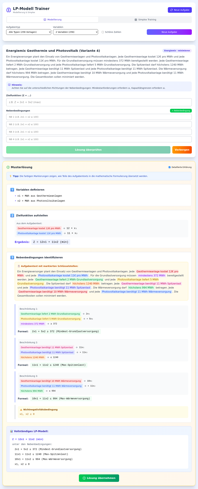
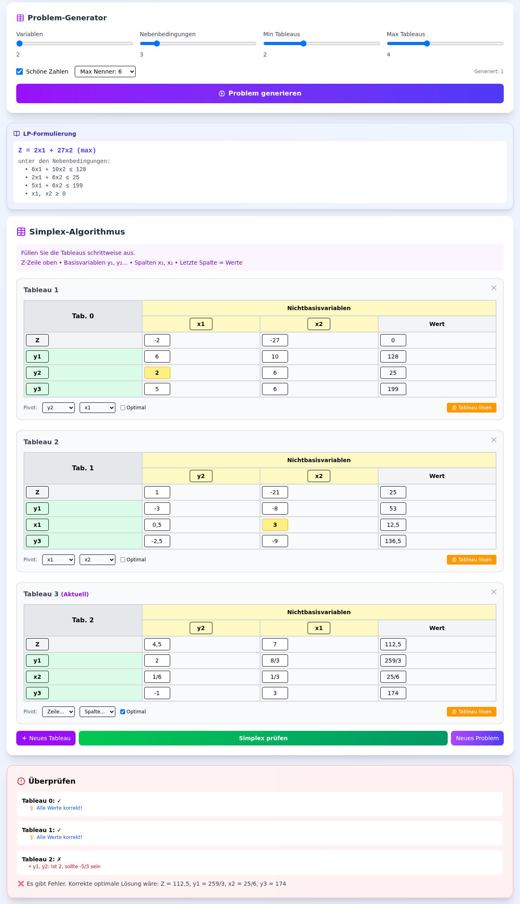

# LP-Modell Trainer

Web-App zum Üben der linearen Optimierung: Textaufgaben in ein LP-Modell übersetzen und das Simplex-Verfahren Tableau für Tableau von Hand durchrechnen, jeweils mit Musterlösung und direktem Feedback. Die App läuft komplett im Browser, ohne Anmeldung und ohne Installation.

**▶ Live-Demo: <https://h4ms7.github.io/lp-trainer/>**

Zwei Modi: [Modellierung](#modellierung) · [Simplex-Trainer](#simplex-trainer)

## Modellierung

Aus einer Textaufgabe das LP-Modell aufstellen: Entscheidungsvariablen, Zielfunktion und Nebenbedingungen.



### Features

- **512 Aufgabenvorlagen in 16 Aufgabentypen:** von Produktions-, Mischungs- und Transportproblemen über Diät- und Schichtplanung bis zu Energiemix und Wartungsplanung, mit 2 bis 5 Entscheidungsvariablen
- **Bei jedem Aufruf neue Zahlen:** Die Vorlagen werden zufällig befüllt, ein Simplex-Löser stellt sicher, dass jede Variante lösbar ist
- **Filter** nach Aufgabentyp und Anzahl der Variablen
- **Schöne Zahlen** (optional): nur Varianten, deren Simplex-Rechnung mit Brüchen mit kleinem Nenner auskommt, gut für das Weiterrechnen von Hand
- **Musterlösung mit Schritt-für-Schritt-Erklärung:** Variablen definieren, Zielfunktion aufstellen, Nebenbedingungen identifizieren, vollständiges LP-Modell
- **Farbige Markierungen** zeigen, welche Stelle im Aufgabentext zu welchem Koeffizienten und welcher Schranke wird
- **Direkt weiter zum Simplex:** Ist das Modell richtig, rechnest du dieselbe Aufgabe im Tableau weiter. Die Prüfung ist genauso exakt wie im Simplex-Trainer, dazu gibt es einen Export als HTML-Datei

### Nutzung

1. Aufgabentyp und Variablenzahl wählen, dann **Neue Aufgabe** klicken.
2. Die Zielfunktion eintragen, z. B. `Z = 12x1 + 11x2 (min)`. Die Variablen heißen `x1`, `x2`, … wie in der Musterlösung.
3. Die Nebenbedingungen eintragen, eine pro Feld, z. B. `2x1 + 5x2 ≥ 372`. Weitere Felder gibt es über **+ Nebenbedingung**. Die Nichtnegativitätsbedingung musst du nicht eintragen.
4. **Lösung überprüfen** gibt eine schnelle Rückmeldung zur Zielfunktion (Koeffizienten, max/min) und dazu, ob genug Nebenbedingungen da sind. Den genauen Abgleich liefert die Musterlösung.
5. **Lösung anzeigen** klappt die Musterlösung auf, **Lösung übernehmen** trägt sie in die Felder ein.
6. Ist das Modell korrekt, geht es mit dem Simplex für dieselbe Aufgabe weiter. Es gelten dieselben Regeln wie im [Simplex-Trainer](#simplex-trainer), dazu kommt:
   - Bei Minimierungsproblemen wird im Tableau mit `-Z` gerechnet.
   - ≥-Bedingungen gehen mit umgekehrtem Vorzeichen ins Tableau (negativer Wert). Solange in der Wert-Spalte negative Werte stehen, kommen zuerst duale Schritte: Die Pivotzeile hat den kleinsten (negativsten) Wert, die Pivotspalte den kleinsten Betrag von Z-Wert ÷ Element (nur negative Elemente).
   - Eine Gleichung wird zu zwei Zeilen, einer ≤- und einer ≥-Bedingung.

## Simplex-Trainer

Zufällig erzeugte LPs mit dem Simplex-Verfahren lösen, Tableau für Tableau.



### Features

- **Problem-Generator:** 2–5 Variablen, 2–10 Nebenbedingungen und die gewünschte Anzahl Tableaus (1–8) frei einstellbar, damit lässt sich die Schwierigkeit steuern
- **Schöne Zahlen:** Auf Wunsch haben alle Werte in allen Tableaus höchstens den Nenner 6 bzw. 12, sodass sie sich von Hand rechnen lassen
- **Keine Wiederholungen:** Innerhalb einer Sitzung kommt kein Problem doppelt
- **Exakte Bruchrechnung:** Eingaben als Bruch (`-5/3`), Dezimalzahl (`2,5` oder `2.5`) oder ganze Zahl; geprüft wird exakt, ohne Rundungsfehler
- **Zellgenaues Feedback:** falsche Werte (z. B. „y1, y2: Ist 2, sollte -5/3 sein“), falsch benannte Basis- und Nichtbasisvariablen, fehlende oder überzählige Tableaus, dazu die optimale Lösung
- **Tableau lösen** als Hilfe: füllt ein Tableau korrekt aus und nennt das nächste Pivotelement bzw. meldet das Optimum
- Das gewählte Pivotelement wird im Tableau farbig markiert

### Nutzung

1. Einstellungen wählen und **Problem generieren** klicken. Das erste Tableau ist in passender Größe vorbereitet.
2. Aufbau des Tableaus: oben die Z-Zeile, darunter eine Zeile je Basisvariable (zu Beginn die Schlupfvariablen `y1`, `y2`, …). Die Spalten sind die Nichtbasisvariablen, die letzte Spalte enthält die Werte. Im Starttableau stehen in der Z-Zeile die Zielfunktionskoeffizienten mit umgekehrtem Vorzeichen.
3. Das Pivotelement über die beiden Auswahlfelder unter dem Tableau festlegen (Zeile = Basisvariable, Spalte = Nichtbasisvariable). Musterlösung und Prüfung folgen dieser Regel:
   - **Pivotspalte:** die Spalte mit dem kleinsten (negativsten) Wert in der Z-Zeile, bei Gleichstand die linke
   - **Pivotzeile:** der kleinste Quotient aus Wert und Element der Pivotspalte, nur über positive Elemente, bei Gleichstand die obere

   > **Hinweis:** Manche Lehrbücher wählen die Pivotspalte anders, etwa die erste negative Spalte von links (Bland-Regel). Dann weicht der Rechenweg von der Musterlösung ab. Der optimale Zielfunktionswert bleibt derselbe.
4. **Neues Tableau** legt das nächste Tableau an und übernimmt die Beschriftungen. Die Pivot-Basisvariable und die Pivot-Nichtbasisvariable tauschst du selbst, die Felder sind editierbar.
5. Steht in der Z-Zeile kein negativer Wert mehr, ist das Tableau optimal: **Optimal** anhaken.
6. **Simplex prüfen** vergleicht alle Tableaus exakt mit dem korrekten Lösungsweg. Werte als ganze Zahl, Bruch oder Dezimalzahl eingeben (`3`, `-5/3`, `2,5`), leere Zellen zählen als 0.

## Lokal starten

Voraussetzung: [Node.js](https://nodejs.org/) 20.19+ oder 22.12+.

```bash
cd app
npm install
npm run dev      # http://localhost:5173/
```

`npm run build` erzeugt eine statische Version in `app/dist/`, die auf jedem Webserver läuft, auch in einem Unterordner. Jeder Push auf `main` baut die Live-Demo automatisch neu und veröffentlicht sie auf GitHub Pages (`.github/workflows/pages.yml`).

## Für Entwickler

```
app/                        React-App (Vite + TypeScript + Tailwind)
  src/LPModellTrainer.tsx   Hauptkomponente
  src/lib/                  Simplex-Löser, Bruchrechnung, Aufgabengenerator, Template-Engine
  src/data/                 Aufgaben und Vorlagen (generiert)
problems/                   Aufgabendaten und Python-Skripte zur Erzeugung und Prüfung
  templates/<typ>/          Vorlagen je Aufgabentyp (JSON, Format siehe SCHEMA.md)
```

Tests:

```bash
cd app
npx tsx src/test-harness.ts all
npx tsx src/test-multivar-flow.ts
```

Neue Vorlagen kommen als JSON nach `problems/templates/<typ>/`. Danach `python3 problems/validate_templates.py` (prüfen) und `python3 problems/merge_templates.py` (nach `app/src/data/templates.ts` übernehmen) ausführen.

## Fehler gefunden? Ideen?

Gerne als [Issue](https://github.com/H4MS7/lp-trainer/issues) melden, zum Beispiel eine Aufgabe mit falscher Lösung oder unklarem Text.

## Lizenz

[GPL-3.0-or-later](LICENSE) © 2026 Felix Flösch
